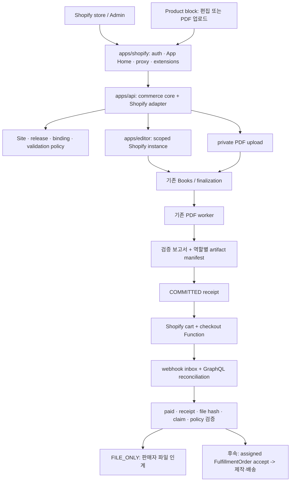
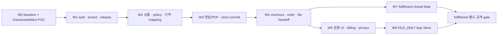

# Storige Editor · PDF Worker × Shopify 개발 착수 정본

> 기준일: 2026-10-15, Asia/Seoul
> 저장소: `/Users/yohan/Developer/Bookmoa Storige editor/storige`
> 구현 감사·핵심 회귀 기준: `ceaf97ef8ba1dab74ba3596e9cc5a009e8c25466`
> 최종 delta 대조: `master` = `origin/master` = `ddd9648225a6531e5e41b2ac010819053a6f5260`
> Shopify 기준: Admin GraphQL / Functions / Webhooks `2026-10`
> 상태: 구현 계획 확정용 개발 문서. Shopify 앱 출시 또는 운영 배포 완료를 의미하지 않음.
> 시각화: [2026-10-15 개발 현황과 흐름](./SHOPIFY_ORCHESTRATION_DEVELOPMENT_GUIDE_2026-10-15.html)
> 인계 절차 정정: 2026-10-18. W0 실행 순서와 미추적 문서의 worktree 인계를 시작 프롬프트·단계별 HTML과 통일했다. 구현 감사 SHA와 20절의 테스트 이력은 기존 2026-10-15 기록이며 새 개발·배포 검증 결과가 아니다.

## 0. 먼저 읽을 결론

Editor와 PDF 검증 Worker를 하나의 Shopify public app 뒤에서 제공하는 구조는 가능하다. 등록 대상은 Shopify 인증·판매자 화면·상품 연동·extension을 제공하는 앱이다. Fabric 편집기, Nest API, Redis/Bull Worker와 PDF 도구는 Storige 인프라에서 계속 실행한다. Worker를 Shopify Function에 옮기거나 PDF 파일을 Shopify 앱 패키지에 넣지 않는다.

판매자마다 별도 앱을 발급하지 않는다. 하나의 production 앱을 여러 store가 설치하고, `Shop GID -> CommerceConnection -> Site`로 분리한다. 같은 운영자가 여러 store를 소유해도 기본값은 store마다 독립 Site다. 각 Site는 자기 템플릿을 등록하고, 읽기 전용 Storige 기본 템플릿을 연결하거나 자기 Site로 복제할 수 있다.

현재 저장소에는 Shopify app shell, 설치 자동화, immutable template release, Shopify 상품 binding, checkout Function, Shopify order projection, fulfillment, 공급가 ledger가 없다. 따라서 기존 편집기 URL만 붙여 App Store에 제출하는 단계는 아니다. 반면 7월에 미구현으로 적었던 tenant·guest·임베드·PDF 처리 기반 중 여러 항목은 이미 구현됐다. 이 문서는 그 코드를 재개발하지 않고 Shopify 경계에 필요한 작업을 정의한다.

최초 공개 범위는 `FILE_ONLY`다. 입력은 `EDITOR_DESIGN`과 `PDF_UPLOAD` 두 경로로 설계하되, 상품 binding별로 명시적으로 켠다. 운영자가 PDF만 검증하는 App Home 도구는 같은 처리 기반을 사용하며, 주문 연결을 따로 승인하기 전에는 구매자의 주문 디자인이 되지 않는다. Storige가 실제 인쇄·배송하는 `STORIGE_FULFILLMENT`는 별도 후속 출시 gate를 둔다.

이 문서는 7월 Shopify orchestration guide와 5월 제안서·기술설계의 구현 지침을 대체한다. 기존 Partner API와 임베드 동결 계약은 [CONTRACT_FREEZE.md](./CONTRACT_FREEZE.md) 및 [PLATFORM_INTEGRATION_GUIDE.md](./PLATFORM_INTEGRATION_GUIDE.md)가 계속 정본이다. Shopify 신규 표면이 기존 계약을 변경할 권한을 주지는 않는다.

### 0.1 변경 요약

| 7월 계획의 전제 | 10월 개발 기준 |
|---|---|
| `10dfaba`와 뒤처진 checkout에서 출발 | `ceaf97ef` 구현 감사 후 `ddd96482`까지 delta 대조. 이전 기준 이후 1,348 commits, 검토 범위 507개 파일 변경 |
| Node 22.12 이상이면 충분 | 저장소는 Node 24를 요구. Shopify CLI 최소와 별도로 Node 24.x 고정 |
| Editor 완료만 입력 경로 | 편집기 디자인, PDF 업로드, 판매자 검증 도구를 구분하고 공통 artifact 파이프라인 사용 |
| tenant/guest/parent-window 검사를 전부 새로 구현 | 현행 구현을 회귀 테스트로 인수하고 신규 commerce 자원에 같은 원칙 적용 |
| offline refresh 재시도 창 1시간 | 2026-08-28 변경 반영. 교체 토큰 사용·30일 복구 상한·원래 만료 중 가장 이른 시점까지 이전 토큰 복구 가능 |
| validation 존재 검사 중심 | 결제 전 서명 receipt 검증 POC를 W0으로 앞당기고 주문 후 서버 검증도 유지 |
| PDF hash 하나면 충분 | 역할별 output manifest, 검증 정책/보고서, 최종화 attempt, 보존 참조를 함께 고정 |
| 페이지 수 가격은 host 메시지로 처리 | 실제 Shopify variant와 검증된 물리 쪽수/규격을 결합. 임의 client 금액을 결제 가격으로 사용하지 않음 |
| 공급가 승인 없으면 FILE_ONLY도 차단 | 편집/PDF 소프트웨어 사용료와 물리 제작원가를 분리. FILE_ONLY는 물리 공급가가 없어도 출시 가능 |
| 모든 wave가 fulfillment 완료를 기다림 | FILE_ONLY App Store gate와 fulfillment gate를 분리. 개인정보 처리는 첫 공개 전 필수 |

## 1. 코드 감사와 구현 상태

### 1.1 기준선과 작업 규칙

`git fetch origin` 후 확인한 구현 감사 HEAD와 remote는 동일한 `ceaf97ef`였다. 문서 저장 시 다른 작업이 만든 4개 commit을 추가 대조해 최종 HEAD/remote `ddd96482`를 확인했다. delta는 worker job 응답 OpenAPI metadata·주석·schema test이고 처리 동작 변경은 없다. 현재 branch는 `master`이며 시작 시 tracked 변경은 없었다. `.tmp-verify-combos/`, 7월 Shopify 문서와 site catalog 초안 등 기존 untracked 파일이 있으므로 경로를 열거해 작업한다. 새 구현 세션은 최신 remote에서 별도 worktree를 만들고 시작 SHA를 기록한다. 이 문서의 SHA를 고정 checkout 명령으로 쓰지 않는다.

이 검토는 저장소와 로컬 테스트 기준이다. 운영 DB, VPS, Vercel의 배포 버전·환경변수·Partner Dashboard의 승인 상태를 실시간 확인한 결과가 아니다. 코드 기본값, compose 기본값, 운영 설정은 구분하고, release 때 실제 `[FLAGS]`와 승인 evidence를 수집한다.

### 1.2 재사용 상태

| 영역 | 현재 사실 | Shopify에서 추가할 것 |
|---|---|---|
| TemplateSet/Template | scoped create/read/write와 site 승계 기반 존재 | 인증된 Shopify staff context, 불변 release, asset closure, system fork 정책 |
| Products/기존 상품 매핑 | 전역·legacy 상품 모델 | Shopify 전용 scoped binding 신설; 기존 매핑을 tenant catalog로 간주하지 않음 |
| Guest edit session | 헤더 token 소유·만료 검증과 생성 시 검증된 JWT 기반 Site stamp 존재 | 조회·저장·버전에도 connection/Site/release를 확인하는 Shopify 전용 subject/launch |
| Host messaging | 정식 envelope, exact origin, `window.parent` 검사와 SDK 존재 | instance/nonce 포함 Shopify protocol adapter, 기존 이벤트 유지 |
| Embed runtime | iframe/IIFE, 저장·재오픈·완료·첨부 PDF 지원 | instance auth/client/storage, credential 없는 Shopify URL, surface별 CSP |
| Worker | 검증·변환·합성, TrimBox, 페이지 채움, retry/stall 처리 | 상품별 정책 snapshot, 공정한 tenant quota, 최종 artifact 검증 bridge |
| Books | `EDITOR_SESSION` / PDF 기반 Book과 비동기 최종화 | strict commerce commit, 역할별 manifest, 파일 보존 pin |
| Worker 응답 | partner projection과 구조화 오류·검증 결과 존재 | 내부 adapter에서 current/legacy result normalization, browser DTO 최소화 |
| Output | 인증된 output URL 재발급 경로 존재 | Shopify staff/order/artifact 권한을 확인하는 다운로드 broker |
| Staff 업무 | 파트너 운영자 grant/audit와 주문 관련 작업 규칙 존재 | Shopify staff 권한·주문 cutoff에 맞는 command mapping |
| Site provisioning | 일반 Site 생성에 legacy editor/worker credential 계약 존재 | Shopify Site에 불필요한 legacy credential을 발급하지 않는 additive 생성 경로 |
| Orders/retention | 외부 주문 식별·파일 결속 설계 자료 존재 | Shopify line/GID root와 canonical retention references; 설계를 구현으로 간주하지 않음 |
| Shopify commerce | 전용 모듈/앱 없음 | 이 문서 W0~W7 범위 신규 개발 |

위 표의 기존 구현은 Shopify 공개 readiness의 완료 판정이 아니다. 예를 들어 scoped TemplateSet 조회가 있어도 검증된 release 자산만 구매자에게 전달하는 commerce bootstrap은 별도다.

현재 template 복제 기능과 “판매자 독립 fork”도 구분한다. TemplateSet copy가 자식 template을 공유 참조할 수 있으므로, 판매자가 독립 수정할 자식은 자기 Site로 복제하고 reference를 다시 연결해야 한다. `site_id IS NULL` 하나만 보고 모든 legacy 데이터가 공식 system catalog라고 간주하지 않는다. Shopify release는 출처와 shared 자격이 명시된 자산만 허용한다.

### 1.3 우선 인수할 코드

- `apps/api/src/templates/template-sets.controller.ts`, `template-sets.service.ts`, `templates.controller.ts`, `templates.service.ts`
- `apps/api/src/auth/guards/tenant.guard.ts`, `common/helpers/tenant-scope.helper.ts`, `auth/api-key-role.ts`
- `apps/api/src/edit-sessions/edit-sessions.controller.ts`, `edit-sessions.service.ts`, guest/session scope tests
- `apps/editor/src/embed.tsx`, `views/EmbedView.tsx`, `api/client.ts`, auth token storage helper, autosave/storage hooks
- `packages/sdk/src/embed/{mount,url,parse,protocol}.ts`
- `apps/api/src/books/book-finalizations.service.ts`, `finalization-error-detail.ts`
- `apps/api/src/worker-jobs/{worker-jobs.service,partner-job-view}.ts`, DTO와 output URL code
- `apps/worker/src/processors/{validation,synthesis}.processor.ts`, retry/stalled helpers
- `apps/worker/src/services/pdf-validator.service.ts`, `utils/trimbox-normalize.ts`, validation config
- `docs/CONTRACT_FREEZE.md`, `docs/PDF_VALIDATION_GUIDE.md`, `docs/FILE_ORDER_BINDING_API_DESIGN_2026-09-24.md`

## 2. Shopify 2026-10 기준

### 2.1 채택 기준

| 표면 | 기준 | 개발 계약 |
|---|---|---|
| Admin API | `2026-10` 최신 stable | Admin 신규 호출은 GraphQL 전용. webhook/Function/extension도 지원 버전 명시 |
| Runtime | CLI 최소 Node 22.12, repo Node >=24 | Node 24.x와 pnpm 9.15.0. scaffold 시 생성된 dependency/CLI 버전 lock |
| App Home | 공식 React Router app + App Bridge | 판매자 UI는 Shopify Admin 안에서 실행. 설치·재설치 인증 후 onboarding |
| Storefront | Theme App Extension product block | live theme에서 merchant 추가·저장 필요. install/deploy만으로 활성 판정하지 않음 |
| Checkout | Cart and Checkout Validation Function | marker/서명/variant 정책 검증. public app의 외부 network lookup에 의존하지 않음 |
| Scope | 최소 권한과 optional scope | 파일 모드에 shipping scope 선제 요청 금지. scope 변경 시 readiness 재계산 |
| Orders/PCD | FILE_ONLY도 order data 사용 | Level 1 요청/검토. 배송 이름·주소 등 필요한 식별 필드는 Level 2 추가 |
| Billing | App Pricing 지원 모델 우선 | 앱 사용료는 Shopify 결제 표면 사용. 공급가 별도 장부·계약 gate |
| Privacy | 필수 compliance topics | 수신 인증과 삭제/열람 처리 모두 첫 공개 전 완료 |

근거: [API versioning](https://shopify.dev/docs/api/usage/versioning), [CLI](https://shopify.dev/docs/api/shopify-cli), [App Store requirements](https://shopify.dev/docs/apps/launch/shopify-app-store/app-store-requirements), [PCD](https://shopify.dev/docs/apps/launch/protected-customer-data).

### 2.2 이번 재검토에서 추가된 API delta

| 변화 | 반영 |
|---|---|
| token refresh 복구 방식 변경 | refresh와 token exchange를 store별 같은 lock/CAS 아래 직렬화. 토큰 쌍을 원자 저장하고 응답 만료값 사용 |
| `FULFILLMENT_NOT_REQUIRED` | FILE_ONLY와 remaining quantity 0을 실패나 출고 완료로 오해하지 않는 enum fixture |
| `RequestedOrderEdit` | 미이행 line 제거 요청이 있으면 해당 제작을 review HOLD. 실제 order edit/cancel과 별도 사건 |
| `orderUpdate` shipping address 변경 시 세금 재계산 | fulfillment에서 목적지 변경 후 재조회한 totals/balance와 승인 규칙으로 판단 |
| `orderCancel.jobResult` | 나중에 cancel mutation을 추가할 경우 비동기 완료 확인. v1은 merchant 취소 사건을 수렴 |
| invalid metafield filter가 오류 반환 | filter 가능한 definition을 설정하고 오류를 빈 검색 결과로 처리하지 않음 |
| CarrierService 자동 profile 등록 제거 | 후속 live rate는 profile/zone 설정까지 검증. 최초 출시는 merchant shipping profile 사용 |
| Next Gen Events | 신규 이벤트 표면은 별도 ADR. 첫 구현은 standard webhook inbox/reconciliation을 유지 |

근거: [2026-10 release notes](https://shopify.dev/changelog/release-notes/2026-10), [refresh 변경](https://shopify.dev/changelog/posts/more-resilient-refreshes-for-expiring-offline-access-tokens), [requested edits](https://shopify.dev/changelog/posts/new-apis-for-buyer-requested-order-edits), [metafield filter](https://shopify.dev/changelog/invalid-metafield-queries-now-return-errors-in-the-graphql-admin-api), [shipping profile 변경](https://shopify.dev/changelog/posts/carrier-services-will-no-longer-be-automatically-added-to-the-default-shipping-profile).

### 2.3 현재 도구와 등록 절차

1. Dev Dashboard에서 development/staging/production 앱과 public distribution을 구분한다. PCD 개발 필드도 distribution 선택 후 설정한다.
2. Shopify CLI 공식 React Router scaffold를 사용해 `apps/shopify`를 생성한다. 신규 Remix scaffold는 사용하지 않는다.
3. `shopify.app.toml`에 app URL, redirect allowlist, scope/optional scope, App Proxy, webhook API version과 compliance topics를 넣는다.
4. 앱 서버는 별도 배포하고, CLI deploy로 app configuration과 extensions의 버전을 올린다. CLI deploy가 Nest API/Worker까지 배포하는 것은 아니다.
5. 서로 다른 development store 두 개에서 install, template isolation, 입력 두 경로, checkout, order UI, uninstall/reinstall을 검증한다.
6. App Store listing·가격·support/privacy URL·테스트 지침·PCD evidence를 제출한다. 승인 전 일반 판매자용 공개 설치를 약속하지 않는다.

## 3. 제품 범위와 운영 모드

### 3.1 입력 모드

| 입력 | 구매자 경험 | 주문 연결 조건 |
|---|---|---|
| `EDITOR_DESIGN` | 상품에 매핑된 release로 디자인하고 완료 | server save -> Book finalization -> strict artifact 검증 -> commit receipt |
| `PDF_UPLOAD` | 상품 규격에 맞는 PDF 업로드·검증·필요 수정 | tenant upload -> report -> fix/revalidate -> Book finalization -> 같은 commit receipt |
| `MERCHANT_PREFLIGHT` | App Home에서 판매자가 PDF 기술 검수 | 기본은 독립 검증 도구. 주문에 쓰려면 해당 binding/release에 새 design commit |

상품별로 `allowed_input_modes`를 설정한다. `EDITOR_DESIGN`과 `PDF_UPLOAD`를 둘 다 허용하는 상품만 선택 UI를 보인다. PDF 업로드는 template 화면을 강제로 만들지 않아도 BookSpec과 상품 policy가 존재하면 동작한다. 입력 허용 여부는 browser 힌트가 아닌 binding revision의 서버 정책이다.

### 3.2 이행 모드

| 모드 | Storige 책임 | 판매자 책임 | 출시 순서 |
|---|---|---|---|
| `FILE_ONLY` | 편집, PDF 검증/합성, 파일 보존·인계, 주문 line 상태 | 소비자 결제·상품 세금·물리 제작·배송·Shopify fulfillment | 첫 App Store 범위 |
| `STORIGE_FULFILLMENT` | 위 기능 + 승인된 물리 제작·배송·tracking | 소비자 판매·환불 정책, 계약·재고/배송 profile 승인 | 별도 closed beta 후 공개 |

`FILE_ONLY`는 구매자 상품이 디지털이라는 뜻이 아니다. 판매자가 인쇄물을 보내는 상품은 Shopify에서 배송 필요 상품으로 유지한다. 파일 생성 완료를 Shopify `FULFILLED`로 바꾸지 않는다. FILE_ONLY에 물리 production_cost를 청구하지 않으며, 편집/PDF 사용료는 software usage다.

`STORIGE_FULFILLMENT`는 배송 가능 국가·제품·SLA·공급가 수금 계약이 승인된 binding에만 적용한다. 도중에 모드를 바꾸면 새 revision으로 적용하고 기존 주문 snapshot은 유지한다. merchant-managed fulfillment와 Storige fulfillment를 한 line에서 암묵적으로 섞지 않는다.

### 3.3 채널 지원

| 채널 | v1 지원 | 처리 |
|---|---|---|
| Online Store 2.0 | 지원 | product app block, 지원 theme/form fixture, live activation 검증 |
| Shopify hosted checkout | 지원 | 활성 Validation Function과 유효 receipt 필요 |
| Accelerated checkout | 조건부 지원 | 편집/검수 commit 전 직접 checkout은 명확한 오류, commit 후 정상 진행 |
| Shop app / Buy Button / custom storefront | 범위 밖 | 해당 상품 publication 제한 안내. 주문 유입 시 자동 처리 없이 HOLD |
| POS / Create Order API / Admin Order Edit | editor flow 미보장 | Function 차단을 약속하지 않음. 서버에서 검증하고 HOLD |
| Draft order | 자동 디자인 flow 범위 밖 | Shopify Function 지원 여부와 별개로 유효 commit/승인 없으면 HOLD |
| Subscription / preorder / B2B 특수가격 | 범위 밖 | selling plan/가격 계약·재주문 정책 전에는 자동 제작 불가 |
| Vintage theme | 범위 밖 | theme source 직접 수정으로 우회하지 않음 |

Function이 지원하지 않는 POS까지 “checkout 차단”이라고 쓰지 않는다. 차단 가능한 Shopify checkout 표면과 주문 후 HOLD 표면을 분리한다. [Function compatibility](https://shopify.dev/docs/api/functions/latest/cart-and-checkout-validation).

## 4. 서비스와 신뢰 경계



### 4.1 코드 소유 경계

| 경로 | 책임 |
|---|---|
| `apps/shopify/app` | Shopify 인증, App Home BFF, app proxy, web route |
| `apps/shopify/extensions/storige-product-block` | 상품 block, variant 변경·cart 연동 |
| `apps/shopify/extensions/storige-cart-validation` | checkout receipt·policy 검증 |
| `apps/shopify/extensions/storige-order-admin` | order line artifact/report/status와 권한 있는 action |
| `packages/shopify-session-storage` | 공식 SessionStorage를 API vault에 연결 |
| `apps/api/src/commerce` | release, binding, design, artifact, order, handoff, retention, ledger |
| `apps/api/src/commerce-shopify` | GID·scope·GraphQL·webhook·fulfillment adapter |
| `apps/api/src/books`, `worker-jobs`, `apps/worker` | 기존 Book/검증/합성 기능. commerce 정책을 queue processor에 넣지 않음 |
| `apps/editor` | scoped runtime과 두 입력의 사용자 UI, legacy adapter 유지 |

Nest service 간 재사용은 내부 service contract로 한다. 같은 Nest API가 자기 endpoint를 `@storige/sdk`로 다시 호출하지 않는다. `apps/shopify`와 API 사이에는 mTLS 또는 timestamp/nonce/audience가 있는 service signature를 사용한다. 브라우저가 전달한 `siteId`·`connectionId`를 권위로 삼지 않는다.

## 5. 설치, 인증, 판매자 권한

### 5.1 Store identity와 설치 세대

- canonical identity는 `platform + Shop GID`, 보조 unique는 canonical `myshopify.com` domain이다. custom/Markets domain은 alias다.
- 신규 install은 Site와 connection을 idempotent하게 만든다. uninstall/reinstall은 같은 identity에서 installation generation을 추가한다.
- token, launch, design, 임시 업로드, webhook payload, PII는 generation을 추적한다. 재설치로 이전 generation 데이터를 새 세대에 자동 복사하지 않는다.
- test/live와 app environment는 서버 설정/검증된 설치에서 결정하고 Book의 `site + env` 경계를 보존한다. buyer body로 live/test를 선택하지 못하게 한다. 환경별 별도 Shopify app과 vault namespace를 쓰며, 같은 DB를 공유한다면 모든 connection unique/lookup에 app environment key를 포함한다.
- `app/uninstalled`와 `shop/redact`는 topic·Shop·발생 시각·처리 이력으로 판정한다. 지연된 uninstall이 새 active generation을 정지시키지 않도록 stale-event fixture를 둔다.
- old generation의 삭제 요청은 기존 개인정보와 파일을 정리한다. 새 token/새 generation과 system shared asset을 broad connection delete로 지우지 않는다. 모호한 사건은 privacy queue에서 사유·기한을 추적한다.

### 5.2 Session vault

공식 React Router 인증기와 SessionStorage를 사용하고, token 원본은 API encrypted vault 한 곳에서만 관리한다. active generation별 refresh/token exchange 공용 lock과 CAS를 둔다. 새 토큰 쌍을 한 transaction으로 저장하고 `expires_in`/`refresh_token_expires_in`을 응답에서 읽는다.

현재 offline access는 통상 1시간, refresh는 발급 시 90일이다. 이전 refresh token은 교체 refresh token 사용, 30일 복구 상한, 원래 만료 중 가장 이른 시점에 종료된다. 앱이 재시도 응답의 동일성을 임의 가정하거나 새 토큰을 버려서는 안 된다. 회전 중 응답 손실·DB 실패를 시험하고, 명확한 invalid/expiry면 `REAUTH_REQUIRED`로 신규 mutation을 멈춘다.

브라우저의 Shopify ID/session token과 Admin API access token을 혼동하지 않는다. background에는 offline token, staff 권한을 존중해야 하는 상호작용에는 online token/associated scope와 app capability를 적용한다. staff별 cache도 connection과 staff ID로 분리한다. [Access tokens](https://shopify.dev/docs/apps/build/authentication-authorization/access-tokens).

### 5.3 Staff capability

App Home 접속만으로 모든 Shopify staff를 global ADMIN으로 만들지 않는다. verified store/user context에서 `template.read/write`, `release.publish`, `offer.write`, `order.read`, `artifact.download`, `settlement.read`, `production.approve`를 평가한다. Shopify가 거부한 staff permission을 앱 offline token으로 우회하지 않는다. app 내부 role도 명시적으로 mapping하며, 재고·상품 mutation은 해당 Shopify permission과 함께 확인한다.

### 5.4 Scope/승인 단계

| 기능 | 후보 scope / 승인 | 비고 |
|---|---|---|
| 상품 조회·생성·binding | `read_products`, `write_products` | DRAFT 생성/연결 UI |
| Theme readiness | `read_themes` | GraphQL로 main product template 확인. source 수정 없음 |
| Markets origin | `read_markets` | 실제 필요한 web presence 조회 |
| checkout validation | `read_validations`, `write_validations` | 생성·활성·health 확인 |
| order projection | `read_orders` + PCD Level 1 | 기본 60일. 내부 snapshot 보존과 API 재조회 권한을 혼동하지 않음 |
| 오래된 order 재조회 | 선택 `read_all_orders` 승인 | 실제 용도 있을 때만 |
| 실제 fulfillment | assigned FO read/write, `write_fulfillments` | 서비스/location·inventory 최소 scope 별도 확정 |
| 배송 PII | PCD Level 2 선택 필드 | shipping 이름·주소·연락처의 필요한 필드만 |
| order mutation | v1 기본 미요청 | requested edit resolve/cancel을 자동화할 때 `write_orders`와 정책 추가 |

실제 scope는 W0 schema/개발 스토어에서 검증한다. 필요한 optional scope가 회수되거나 write→read로 줄면 관련 readiness와 action을 즉시 갱신한다.

## 6. 몰별 template · release · 상품 계약

### 6.1 Authoring과 release

판매자 authoring TemplateSet과 주문용 release를 분리한다. 편집 가능한 원본을 수정해도 이미 committed된 디자인이나 주문은 바뀌지 않아야 한다.

publish 시 TemplateSet, Template, 이미지, font, library asset, BookSpec 참조를 검사한다. 참조는 자기 Site 또는 명시적 system shared만 허용한다. snapshot에는 file ID/hash/storage version을 넣고 만료 URL은 넣지 않는다. bootstrap 시 grant가 허용한 manifest 자산에만 짧은 signed URL을 발급한다. 폐기·미검사 asset이 있으면 publish하지 않는다.

system release는 읽기/연결 전용이다. 판매자가 바꾸려면 자기 Site로 fork하고 새로운 local asset ownership과 release를 만든다. 기존 legacy `product_template_sets`의 shared/null 규칙을 Shopify binding으로 확대하지 않는다.

fork는 source/provenance를 남기고, 독립 편집할 template·asset reference를 자기 Site로 재작성한다. 기존 shallow copy만 호출해 독립 복제를 완료했다고 판정하지 않는다.

### 6.2 Binding revision

binding은 connection, exact product/variant GID, release, input mode, BookSpec, validation policy, page count rule, fulfillment mode, supply price version을 결합한다. product default를 지원하면 exact variant 우선 규칙과 active default unique를 둔다. revision activation 후 내용은 불변이고 교체 시 새 revision을 만든다.

상품 생성 기본값은 DRAFT다. 판매자가 이미지·설명·판매가·세금·배송·재고·channel을 확인한 뒤 명시적으로 publish한다. 기존 상품을 연결할 때도 해당 Shop에서 조회한 GID인지 확인한다. system template을 연결한다고 Shopify 상품이 자동으로 모든 channel에 공개되면 안 된다.

### 6.3 페이지 수와 가격

`editor.pricingChange`는 기존 호스트 표시 계약이다. Shopify checkout 가격을 변경하는 명령이 아니다. line property의 금액·쪽수나 브라우저 계산값은 Shopify 결제 금액의 정본이 될 수 없다.

v1 가격 방식은 다음 중 binding별 하나로 고정한다.

- `FIXED_SPEC`: variant별 판형/제본/허용 쪽수와 가격이 고정된다. 검증된 결과가 다르면 cart 추가를 막는다.
- `VARIANT_TIER`: 검증된 물리 쪽수/옵션이 서버의 허용 variant tier에 mapping된다. 해당 variant와 새 binding/receipt를 확정한 뒤 cart에 넣는다.

Plus 전용 임의 price override, draft order 우회 결제, 디자인마다 상품/variant 무제한 생성은 v1 기본값에 넣지 않는다. 페이지 변경으로 variant가 바뀌면 기존 receipt를 재사용하지 않고 exact variant에 다시 commit한다. 할인·Markets contextual price·세금은 Shopify의 retail money를 유지하고 supply price와 섞지 않는다. [Cart line](https://shopify.dev/docs/api/storefront/latest/objects/cartline), [Cart Transform 제약](https://shopify.dev/docs/api/functions/latest/cart-transform).

### 6.4 Live readiness

`READY_TO_SELL = installation/auth healthy AND scopes healthy AND active binding/release AND origin healthy AND live product block compatible AND enabled checkout validation AND policy synced`다. fulfillment mode는 PCD/assigned location/계약 readiness를 추가한다.

Theme App Extension 설치만으로 block은 추가되지 않는다. main theme와 product `templateSuffix`의 JSON을 parser로 읽고, 해당 app block이 실제 순서에 포함되며 section/block이 disabled가 아닌지 확인한다. 앱 block이 다른 상품 resource를 가리키거나 app 전용 비활성 설정이면 healthy가 아니다. JSON 검출만으로 실제 form 동작까지 보장하지 않으므로 지원 theme별 variant/Ajax cart/cart drawer/dynamic checkout smoke도 필요하다.

Theme publish/update, product template 변경, block 제거, Markets/domain 변경 시 health를 무효화한다. 신규 launch는 건강한 binding에만 허용하고, policy sync 실패는 App Home에서 복구 가능한 상태로 표시한다. [Theme app extension](https://shopify.dev/docs/apps/build/online-store/theme-app-extensions/configuration).

## 7. Editor · 업로드 실행과 격리

### 7.1 Storefront launch

1. product block이 현재 variant와 input mode를 App Proxy로 요청한다.
2. 공식 query signature canonicalization, timestamp 허용창, signed nonce/digest, verified Shop을 확인한다. `X-Forwarded-Host`는 synced active origin과 비교한다.
3. product/variant는 client 힌트로 받고, 해당 connection의 active binding을 서버에서 다시 조회한다. proxy signature가 request body와 구매자 소유권을 모두 보장한다고 가정하지 않는다.
4. 짧은 one-time grant에 site/connection/installation, subject, binding/release/policy, exact parent origin, instance, nonce를 고정한다.
5. 고정된 editor host의 `/embed/shopify/{grant}` 또는 upload surface를 연다. URL에 Shopify access token, Storige refresh token, 임의 API origin을 넣지 않는다.
6. grant를 메모리 scoped credential로 1회 교환한다. log/referrer/cache에서 grant를 마스킹하고 첫 응답은 no-store/no-referrer다.

App Proxy는 shopper 로그인 없이도 호출될 수 있다. design UID를 안다는 이유로 기존 작업을 재오픈하지 않는다. logged-in customer ownership 또는 instance recovery credential이 필요하며, guest 신규 launch가 다른 subject의 design을 이어받을 수 없다. [App Proxy authentication](https://shopify.dev/docs/apps/build/online-store/app-proxies/authenticate-app-proxies).

### 7.2 Runtime contract

Shopify 전용 route에는 `authProvider`, `apiClientFactory`, `storageProvider`, `hostBridge`를 주입한다. legacy `/embed`와 SDK event 명칭·payload·명령 응답 유형은 유지한다. singleton `baseURL`이나 origin 공용 token store를 Shopify credential의 출처로 쓰지 않는다.

singleton의 영향 범위는 JS realm이다. 별도 iframe 두 개의 singleton이 직접 공유되는 것은 아니지만 같은 문서의 IIFE instance는 공유할 수 있다. browser storage partitioning도 환경마다 다르므로 tenant 인증·복구 격리의 대체 수단으로 삼지 않는다. 관리자 fragment/sessionStorage와 guest reopen 보강을 Shopify memory-only 인증 완료로 계산하지 않는다.

postMessage는 exact `event.origin`, `event.source`, instance ID, nonce, schema version을 확인한다. target origin은 grant에서 얻는다. 메시지에는 design 상태/opaque ID만 싣고 token·원문 canvas·공급가·PII는 넣지 않는다. 기존 formal envelope는 재사용하되 Shopify parent와 legacy dual emit의 실행 경로를 명시적으로 선택한다.

서버 autosave가 권위 저장이다. 비밀 credential은 durable browser storage에 쓰지 않는다. backup/preset/preferences는 connection/design/instance namespace와 TTL을 가지며 한 몰의 복구·삭제가 다른 몰에 영향을 주지 않는다. raw 개인 사진/canvas durable backup은 승인된 암호화 recovery 계약 전에는 Shopify route에서 비활성화한다.

one-time grant 사용 후 reload/back/bfcache를 고려한다. 같은 instance의 단기 memory credential이 살아 있으면 복구하고, 사라졌으면 host가 새 grant를 요청해 server autosave를 재개한다. grant 재사용 또는 query token fallback은 사용하지 않는다. guest 장기 재오픈은 별도 제한된 recovery handle 정책으로 구현한다.

### 7.3 CSP 표면 분리

구매자 iframe은 exact storefront origin, 판매자 App Home은 Shopify Admin/해당 store ancestor, App Home 안의 중첩 editor는 실제 ancestor chain 전부를 허용해야 한다. CSP `frame-ancestors`는 바로 위 부모만 검사하는 것이 아니다. merchant template authoring route를 구매자 launch route와 같은 CSP 함수로 처리하지 않는다.

동적 middleware, reverse proxy, Vercel 정적 header가 중복되어 유효 CSP가 의도와 다르지 않은지 deployed response로 확인한다. template editor의 asset/font 접근도 해당 staff capability를 확인한다. [Shopify iframe protection](https://shopify.dev/docs/apps/build/security/set-up-iframe-protection).

기존 CSP domain 목록도 frozen 계약이다. Shopify route를 기존 공용 목록 병합보다 먼저 분기하고 그 경로에만 exact 정책을 적용한다. legacy wildcard/domain을 전역 삭제하는 변경은 이 Shopify 계획에 포함하지 않는다.

### 7.4 PDF upload

upload intent는 grant와 design에 결합하고 허용 MIME, bytes, file role, policy를 서버에서 고정한다. MIME 선언만으로 PDF를 신뢰하지 않고 실제 parsing/quarantine를 거친다. Shopify Files/public CDN을 비공개 인쇄 원본 저장소로 쓰지 않는다. 기존 files/presigned complete를 감싼 scoped internal service를 사용하고, storefront에 site API key를 제공하지 않는다.

현재 files 일반 업로드 상한은 `100 * 1024 * 1024` bytes다. Worker의 별도 `WORKER_MAX_FILE_SIZE` 또는 스트리밍 가능 용량을 Shopify 업로드 상품의 지원 용량으로 광고하지 않는다. presigned 경로는 storage/complete의 실제 제한을 따로 검증해야 한다. v1 Shopify upload cap은 모든 경로에서 100 MiB 이하로 맞추고 큰 파일은 별도 ticket/부하 검증 후 연다.

인쇄 원본은 처리 job/retention reference와 같은 Site에 stamp한다. source URL을 임의 fetch하지 않고 내부 file reference만 worker에 전달한다. 검사 전 upload, thumbnails, job logs에는 개인정보가 있을 수 있으므로 보존 기한·권한·삭제를 적용한다.

## 8. PDF 검증 · 최종화 계약

### 8.1 상태를 구분한다

```text
Upload/Editor draft
  -> SOURCE_SAVED
  -> VALIDATING
       -> REJECTED
       -> FIX_REQUIRED -> 새 corrected source -> VALIDATING
       -> TECHNICALLY_VALID
  -> FINALIZING
  -> OUTPUT_VALIDATING
  -> COMMITTED
  -> CLAIMED_BY_ORDER
```

worker job `COMPLETED`, report `isValid`, Book `FINALIZED`, commerce `COMMITTED`, Shopify order `PAID`, 물리 `FULFILLED`는 다른 사실이다. validation job 상태만으로 cart에 넣지 않는다. `FIXABLE`은 통과가 아니며, warning 승인도 상품 정책에 따라 별도 기록한다.

기존 `editor.complete`와 세션 `VALIDATED`도 strict 인쇄 승인으로 승격하지 않는다. 공개 임베드의 완료 의미를 바꾸는 대신 Shopify adapter가 draft save·PDF 생성·Book 처리·artifact gate를 별도로 확인한다.

### 8.1.1 현재 Book 지원 범위

| 입력 | 현재 Book 경로 | Shopify에서 필요한 보완 |
|---|---|---|
| `PDF_UPLOAD` 책자 | cover/content 자산 필수, 최종화의 선행 검증은 주로 content 대상 | cover/spine/wrap와 output phase를 역할별 추가 검증 |
| `EDITOR_SESSION` | 완료 세션 산출물 승격, merged PDF를 content 의미로 검증하는 경로 존재 | 세션 revision 고정, 역할/spec/pages의 의미 분리, 별도 strict 검증 |
| 단일 PDF 검수 도구 | 저수준 validator로 가능 | 검수만 완료한 상태와 cart/order commit 분리 |
| 단일 PDF를 상품 최종본으로 사용 | 기존 PDF_UPLOAD Books가 임의 단일 파일을 자동 분리해 주지 않음 | W0에서 additive Book/role adapter 확정. 수용 전 해당 상품 binding 비활성 |

표지/내지 없는 단일 인쇄물에 가짜 cover나 빈 content를 생성해 기존 필수 자산 조건을 통과시키지 않는다. POC-004에서 필요한 입력 family별 adapter를 확정하고 실제 지원 family만 첫 listing에 기재한다.

### 8.2 Validation policy snapshot

binding revision은 다음을 불변 policy로 가진다.

- BookSpec/trim, bleed, cover layout, wrap/wing/spine formula와 tolerance
- 물리 쪽수 최소·최대·배수와 spread/logical-page 변환 규칙
- 허용 파일 역할: cover/content 또는 single, separate output 필요 여부
- input size limit, page limit, DPI/color/font/annotation/overprint 처리 정책
- error 차단 목록, warning acknowledgement 목록, 실제 제공 fix method
- policy schema/version/hash, 필요한 API/Worker flag profile과 toolchain fingerprint

기존 validator에서 warning인 항목을 global error로 바꾸지 않는다. 예를 들어 order expected page count가 다르면 commerce policy가 별도로 commit을 차단할 수 있다. 물리 쪽수와 editor 화면 수, spread PDF page 수를 혼동하지 않는 mapping test를 둔다. 규격을 client body에서 재정의하지 않는다.

### 8.3 입력·수정·출력 검증

1. `EDITOR_DESIGN`은 server edit-session revision을 고정해 Book을 만들고, `PDF_UPLOAD`는 업로드 file hash·role을 고정해 Book asset으로 등록한다.
2. 기존 validation/convert/synthesis/finalization service를 재사용한다. 동일 commit attempt는 같은 Book/finalization을 진행하며 timeout이 새 Book을 만들지 않는다.
3. `autoFixable`은 배선된 실행기와 policy가 모두 허용할 때만 UI action을 보인다. 수정은 새 file revision으로 저장하고 원본을 보존한다.
4. 페이지 채움, 도련 확장, TrimBox 정규화, 색상/주석 변환 뒤 결과 파일을 다시 검증한다. 수정 전 report를 새 bytes에 붙이지 않는다.
5. 표지/내지 분리 상품은 역할별 output을 모두 수집한다. 하나의 merged PDF만을 가정하지 않는다.
6. 최종 output manifest와 report의 hash·bytes·page/box metadata를 함께 고정한다. 합성 완료만으로 최종 출력 검수가 끝났다고 판정하지 않는다.

qpdf/Ghostscript/Poppler 등은 실제 worker container에 필요한 도구가 있는지 startup/readiness로 확인한다. 스캔이 일부 페이지만 수행됐거나 시간 제한으로 생략된 항목은 report의 coverage에 남긴다. 기술 검수 통과를 최종 인쇄 품질 보장으로 표시하지 않는다.

현재 `addBlankPages`, `extendBleed` 실행기를 우선 재사용한다. `resizeWithPadding`, `adjustSpine`은 실행 가능한 기능이라고 표시하지 않는다. `SPINE_PARAMS_UNRESOLVED`처럼 필수 검사가 수행되지 않았다는 고지는 단순 warning 동의로 통과시키지 않고 required coverage 미충족으로 commit을 막는다. 수정 job 완료 시 outputFileId 등록이 끝났는지도 확인하고, ID/bytes가 확정되기 전 재검증을 시작하지 않는다.

### 8.4 COMMITTED 불변조건

다음 전부가 참이어야 commit receipt를 발급한다.

1. site/connection/installation과 input/binding/release/policy ownership 일치.
2. 현재 commit attempt가 참조하는 Book이 `FINALIZED`이고 `validationSkipped === false`.
3. validation report가 policy에 맞는 최신 input과 **실제 output**을 검증했고 hard error가 없음.
4. BookSpec, role, 물리 쪽수, trim/bleed/cover geometry가 binding 계약과 일치.
5. 각 output의 private storage reference, SHA-256, byte count, role이 확정됨.
6. 필요한 warnings acknowledgement가 report revision/hash에 결합됨.
7. cart 만료/주문 보존용 retention reference가 생성돼 background cleanup에서 보호됨.

기존 Books의 skip 동작을 전역 변경하지 않는다. Shopify commerce bridge에서 strict precondition을 적용한다. BookSpec만 주면 모든 validator 옵션과 최종 output 검증이 자동 적용된다고 가정하지 않고 실제 배선을 W0 POC에서 확인한다.

finalization snapshot의 file ID만으로 bytes 불변을 증명할 수 없으므로 실제 output을 content hash/object version으로 고정한다. 같은 hash를 계산한 bytes와 이후 인계 bytes가 같아야 한다. 원본 session 수정, output path 재사용, 파일 등록 재시도 후에도 과거 주문 manifest가 바뀌지 않는 테스트가 필요하다.

### 8.4.1 단계 선점과 복구

Shopify commit bridge는 `(connection, design revision, stage)`의 영속 unique operation을 먼저 선점하고 outbox로 enqueue한다. 기존 최종화의 상태 CAS만으로 queue 생성까지 한 번이라고 가정하지 않는다. 최종화 내부 합성 생성도 외부 operation key를 수용하는 additive hook/unique reservation을 ADR로 정하고, 같은 queue/provider를 사용한다.

진행 중 재호출은 같은 operation을 조회한다. 실패 후 source/policy를 바꾸는 경우 새 revision/attempt를 만들고 과거 key를 재사용하지 않는다. enqueue 전후 crash, 조기·중복 callback, status callback 손실, sweeper timeout 뒤 늦은 성공, output 등록 실패를 reconciliation으로 복구한다. late success는 이미 FAILED/취소된 design을 자동 COMMITTED로 만들지 않고 현재 attempt와 source/hash를 대조한다.

동일 입력의 인쇄 수량 변경은 PDF page count 변경이 아니다. 허용된 수량 변경 때문에 최종 PDF를 재합성하지 않으며, 주문 수량 revision과 결제/공급가를 다시 검증한다.

### 8.5 Worker response adapter

현행 partner job view의 14개 top-level key는 `id`, `jobType`, `status`, `editSessionId`, `sessionId`, `outputFileId`, `outputFileUrl`, `errorCode`, `createdAt`, `completedAt`, `options`, `result`, `errorMessage`, `errorDetail`다. 외부 신규 필드를 기대하는 코드를 만들지 않는다.

최종 delta 기준 OpenAPI `PartnerJobViewDto`는 projection을 거치는 9개 operation이 참조하며, 그중 production 공개 문서 allowlist는 7개다. fix-bleed/첨부 page-pad를 공개 파트너 API라고 새로 광고하지 않는다. response metadata 통일은 runtime 인증/지원범위를 바꾸지 않는다.

VALIDATE report는 현행 `job.result.result`와 과거 flat `job.result` 형식을 내부 adapter에서 schema 검증 후 normalize한다. 판정 필드는 `isValid`; 구형 type의 `valid/fileInfo`를 신규 코드에서 사용하지 않는다. 사람용 message로 분기하지 않고 status/code를 사용한다. 최종화 실패의 `errorDetail.jobErrorCode`와 stage를 복구 UI에 mapping한다.

브라우저용 Shopify report DTO는 allowlist 형태로 별도 정의한다. worker URL/path/log/내부 options를 그대로 반환하지 않는다. 기존 partner response projection과 frozen DTO를 Shopify UI 때문에 변경하지 않는다.

### 8.6 Output/retention

산출물 URL은 식별자가 아니다. 파일 조회 때 authenticated output-url 또는 내부 storage resolver로 새 signed URL을 받고, 당시 staff/subject·Site·order line·artifact ownership을 다시 검증한다. 옛 `/storage/outputs/` 공개 경로나 만료 URL을 Shopify line property/metafield에 저장하지 않는다.

현재 file-order-binding 문서는 설계이며, 해당 구현 유무를 실제 모듈로 확인한다. Shopify `gid://...`를 bigint `orderSeqno/memberSeqno`나 길이 제한된 partner orderRef에 억지로 넣지 않는다. Commerce가 자기 internal line UUID와 retention reference를 갖고, 기존 결속 모듈이 완성되면 명시적 adapter로 연결한다.

COMMITTED artifact는 적어도 receipt TTL까지, 주문에 claim되면 계약된 보존 기한까지 보호한다. source, corrected source, role outputs, thumbnails, Book asset, worker output의 모든 경로를 GC가 인식해야 한다. reference 추가와 cleanup의 경합은 row lock/CAS로 방지한다. 개인정보 삭제/legal retention은 별도 policy로 처리하며 단순히 파일을 영구 pin하지 않는다.

## 9. Cart · checkout · 주문 검증

### 9.1 Receipt와 Function POC

필수 상품 metafield는 app-owned namespace에 `requires_artwork`, allowed binding revisions, receipt schema/key version을 둔다. cart property는 opaque project UID와 compact signed receipt만 포함하고 PII·공급가·file URL은 넣지 않는다. underscore/private property도 비밀 저장소가 아니다.

서명 payload는 connection/shop 식별, input type, design UID, exact variant GID, binding/policy revision, artifact manifest digest, issue/expiry, key ID를 결합한다. 공개 검증 material만 Function config에 제공하고 private signing key는 API vault에 둔다.

receipt key와 payload도 installation generation/app environment에 묶는다. old install의 서명 material을 새 install이 자동 신뢰하지 않으며, 정상 key rotation만 명시된 overlap window를 둔다.

W0 POC에서 실제 Function input schema, 속성 길이, 최대 지원 cart 규모의 Wasm instruction/resource 한도, Rust crypto 검증, rotation overlap을 확인한다. 통과하기 전 algorithm이나 지원 cart 최대치를 확정하지 않는다. 실패하면 “형식만 확인하는 checkout”으로 자동 대체해 출시하지 않는다. 제한된 범위 또는 별도 ADR을 정해 공개 전 gate를 다시 통과한다.

Function은 local receipt와 variant/policy를 검사한다. public app에서 Storige API를 실시간 호출해 Book revocation/claim 여부를 확인하지 못하므로 서버의 주문 후 검증이 계속 필요하다. valid receipt 재사용·동시 주문의 경우 첫 claim만 자동 처리되고 나머지는 HOLD될 수 있다는 운영 흐름도 테스트한다. [Function API](https://shopify.dev/docs/api/functions/latest/cart-and-checkout-validation), [validationCreate](https://shopify.dev/docs/api/admin-graphql/latest/mutations/validationCreate).

### 9.2 Storefront cart 계약

- commit 전 add-to-cart를 잠근다. finalization은 비동기 progress/취소/실패 재개를 제공한다.
- 같은 variant라도 서로 다른 design UID는 별도 line이다. 수량 증가는 같은 디자인 복수부다.
- cart line key/ID가 변할 수 있으므로 variant ID 하나로 업데이트하지 않는다. properties 업데이트가 다른 properties를 지우지 않도록 병합하고, 새 cart snapshot에서 line을 다시 찾는다.
- variant 변경·재편집은 기존 line을 즉시 덮지 않는다. 새 commit 성공 후 원자적으로 line 교체하고 실패하면 기존 line을 유지한다.
- 재주문은 명시적 duplicate/recommit으로 새 design/receipt를 만든다. 이미 claim된 receipt를 주문 복사로 재사용하지 않는다.
- 만료 receipt는 server 상태 확인과 새 receipt 발급으로 복구한다. revocation은 Shopify policy sync와 production gate에 모두 반영한다.
- validation은 enabled와 blockOnFailure를 확인한다. store당 활성 25개 상한/disabled/runtime error를 readiness에 표시한다.
- 비 Storige cart line과 line 삭제가 불필요하게 막히지 않는 buyerJourney/empty-cart fixture를 둔다.

### 9.3 Webhook과 주문 권위

표준 webhook은 raw body HMAC 검증 후 Shopify delivery ID로 dedupe하고 durable inbox에 저장한 뒤 빠른 2xx를 반환한다. payload·header를 로그에 그대로 쓰지 않는다. 소비자는 connection별 GraphQL queue로 최신 Order와 line을 조회해 projection을 수렴시킨다. event 순서는 상태 전이 순서가 아니다.

order processing gate는 다음과 같다.

```text
known active connection
AND supported source/purchase option
AND current line variant/binding compatible
AND valid committed artifact + output manifest/hash + retention
AND unique design claim
AND policy-defined payment ready
AND no cancel/refund/requested-edit/risk HOLD
AND (FILE_ONLY OR assigned fulfillment request accepted)
```

`orders/paid`에서 PDF 재합성/물리 제작을 바로 호출하지 않는다. DB transaction으로 claim·order line snapshot·outbox를 기록한다. consumer effect는 internal source UUID unique로 한 번만 발생한다. physical enqueue 직전에는 financial/refund/risk/pending edit 상태와 cutoff를 다시 읽고 CAS한다. Shopify와 사내 DB 사이에 완전한 분산 transaction은 없으므로 직후 외부 변경은 cutoff exception queue로 처리한다.

### 9.4 주요 사건

| 사건 | 기본 정책 |
|---|---|
| 미결제/authorized/COD | 자동 인계·제작 기본 HOLD. 결제 수단별 승인 정책 별도 |
| Order Edit line 추가·variant 변경 | 새 유효 commit 필요. Function이 보호한다고 가정하지 않음 |
| 수량 증가 | 허용량·결제 잔액 재검증. cutoff 뒤 자동 증산 금지 |
| 수량 감소/line 삭제 | cutoff 전 취소·수량 조정, 이후 운영 예외 |
| `requested_order_edit/created` | 요청만으로 취소하지 않고 해당 line `HOLD_REQUESTED_EDIT` |
| requested edit resolve/decline | 최신 order/요청 상태 조회 후 gate 재계산 |
| Refund | 소비자 환불과 제작 취소/공급원가 reversal 분리 |
| 취소 | 미시작 작업 취소, 시작 후 cutoff policy |
| 주소 변경 | fulfillment에서는 목적지/세금/잔액 snapshot 재검증 |
| uninstall | 신규 launch/인계·제작 수락 정지. in-flight 책임을 runbook으로 처리 |

worker retry·출력 파일 재조회·duplicate webhook으로 동일 사용료/물리원가를 중복 청구하지 않는다.

### 9.5 최소 수신 topic과 reconciliation

install/scope: `app/uninstalled`, `app/scopes_update`.
privacy: `customers/data_request`, `customers/redact`, `shop/redact`.
catalog/theme: product update/delete, theme publish/update와 Markets/domain 변경에 대한 재동기화.
orders: create/paid/updated/edited/cancelled, refund/transaction, `requested_order_edit/created|resolved|declined`.
fulfillment 후속: assigned FO request/cancel/move/split/merge/hold, fulfillment/tracking와 필요한 risk 사건.

정확한 topic identifier와 scope는 `2026-10` schema fixture로 고정한다. 지원되지 않는 topic을 추측 등록하지 않는다. standard webhook 수신과 fulfillment service notification은 protocol별 guard를 분리한다. 누락 사건을 connection별 cursor reconciliation으로 복구하고 60일 이전 제한은 승인된 scope 또는 내부 snapshot 범위로 처리한다.

## 10. 신규 모델과 API 계약

### 10.1 모델

신규 ID는 UUID, 외부 GID는 string, 시간은 UTC, 돈은 decimal+ISO currency다. 기존 UUID entity·MariaDB/TypeORM 패턴을 따른다. 일반 DB invariant를 PostgreSQL partial index 문법으로 그대로 옮기지 않는다. MariaDB의 nullable unique/generated column 또는 명시적인 active-pointer lock 설계를 사용한다.

| Aggregate/table | 필수 필드·불변조건 |
|---|---|
| `commerce_connections` | Site 1:1, Shop GID unique, canonical domain, active_installation_id, status/readiness, mode |
| `commerce_installations` | connection+generation unique, installed/uninstalled/event watermark, redaction_due_at, status |
| `commerce_connection_secrets` | installation/session unique, encrypted token pair, expiry, token generation/CAS, key version |
| `commerce_receipt_keys` | installation+key ID unique, algorithm, encrypted private/public verification material, active/retiring/retired와 verifyUntil |
| `commerce_storefront_origins` | connection+exact HTTPS origin, source, verified/stale/revoked |
| `template_set_releases` | source/site, immutable snapshot/asset manifest/hash, BookSpec, publish/revoke |
| `commerce_validation_policies` | immutable validation config/hash, flag/tool profile, page/role/warning policy |
| `commerce_offer_bindings` | connection + product/variant, current revision, status |
| `commerce_offer_binding_revisions` | release nullable for upload-only, policy, spec, input modes, variant/pricing rule, supply/mode snapshot |
| `commerce_subjects` | connection/site/installation, guest/customer type, scoped pseudonymous identity |
| `commerce_launch_grants` | one-time digest, exact origin/audience, subject/instance/nonce, revision, TTL/status |
| `commerce_designs` | connection/site/installation, input_type, edit session or upload refs, commit attempt, Book, state |
| `commerce_artifact_manifests` | design/revision immutable, role outputs, SHA-256/bytes/spec/pages, validation report hash, storage refs |
| `commerce_validation_reports` | input/output phase, source hash, policy/tool/flag version, coverage, normalized issues, acknowledgement |
| `commerce_design_claims` | design unique, internal order-line UUID, claimed_at. 취소해도 UID 자동 재사용 안 함 |
| `commerce_orders/lines` | connection+Order/Line GID unique, source/external updatedAt, financial/refund/requested edit, binding/retail/supply/mode snapshot |
| `commerce_handoffs` | line source unique, manifest, status/readyAt. FILE_ONLY file delivery와 물리 제작 분리 |
| `production_orders` | 후속 physical line source unique, quantity/cutoff/status. Partner Stage 6와 공유 ADR |
| `commerce_retention_references` | file/storage artifact + owner/type/expiry/legal hold, cleanup과 원자 보호 |
| `commerce_webhook_deliveries` | platform+delivery ID unique, installation attribution, topic/version/times/hash, minimal encrypted TTL payload |
| `commerce_outbox_events` | aggregate/type/version/idempotency key unique, retry/DLQ |
| fulfillment/shipments | FO/FO-line GID, assignment/delivery method/remaining quantity, partial shipment lines, encrypted destination |
| price/ledger/statement | versioned supply rule, decimal+currency, append-only charge/reversal/payment, finalized statement |
| app billing | software meter event만, provider result/idempotency, internal usage와 수금 상태 구분 |

`commerce_designs`는 편집기/PDF 입력의 공통 artwork project다. PDF_UPLOAD에 canvas/session을 억지 생성하지 않는다. Book은 production artifact 기반이고 Shopify order/billing 컬럼을 Books entity에 직접 추가하지 않는다.

### 10.2 API 표면

아래는 신규 logical contract다. prefix와 DTO는 W0 OpenAPI에서 확정하며 기존 partner route를 rename하지 않는다.

| 표면 | Method/path | 권위 |
|---|---|---|
| App Home | `GET /app/api/readiness` | verified store/staff |
| Catalog | `GET/POST /app/api/bindings`, `POST /app/api/products/draft` | staff capability + same Shop GID |
| Template | draft CRUD, `POST /app/api/template-sets/{id}/publish` | staff+Site capability |
| Merchant PDF tool | `POST /app/api/preflight/intents` | staff quota, own Site |
| Storefront | `POST /apps/storige/launch` | verified App Proxy + active binding |
| Grant | `POST /api/commerce/launch/{grant}/redeem` | one-time grant |
| Upload | `POST /api/commerce/designs/{id}/upload-intents`, `/uploads/{id}/complete` | instance+design+file role |
| Report | `GET /api/commerce/designs/{id}/operations/{op}` | instance/resource ownership |
| Fix | `POST /api/commerce/designs/{id}/fixes` | report/policy version + executable method |
| Commit | `POST /api/commerce/designs/{id}/commit` | instance, idempotency, strict artifact gate |
| Orders | `GET /app/api/orders/{id}`, line actions | store/staff capability |
| Download | `POST /app/api/order-lines/{id}/artifact-access` | staff+line+file, short-lived URL |
| Shopify events | `POST /webhooks/shopify` | raw HMAC and topic schema |
| Fulfillment callback | `POST /fulfillment/{connectionLocator}/fulfillment_order_notification` | verified Shopify HMAC/shop; locator is not authority |

비동기 command는 operation ID와 structured status를 반환한다. retry는 같은 operation/idempotency key를 유지한다. browser 응답에 Shopify token, site legacy key, raw worker options를 넣지 않는다.

## 11. 판매자 운영 화면

App Home 첫 화면은 onboarding/readiness와 실제 운영 목록이다.

- 연결: store, token/scope health, 필요한 재승인, 마지막 sync, 활성 설치 세대.
- 템플릿: 내 draft/release, 기본 template, fork/publish/revoke, asset/license/quota.
- 상품: Shopify product/variant, input mode, release/BookSpec/page tier, 소비자가와 공급가의 구분, active theme/validation health.
- PDF 검수: 업로드/검증/수정/재검증, 차단/경고/검사 coverage, 사용량과 파일 TTL.
- 주문: line별 preview, input mode, report, immutable output 역할, 결제/HOLD/cutoff, 다운로드/후속 tracking.
- 정산: software usage/Shopify billing과 physical supply ledger/statement를 별도 표시.
- 운영: 재동기화, 실패 operation retry, 지원 요청, cleanup/uninstall 준비.

Order Admin extension은 현재 주문과 관련된 디자인·검수·산출물·HOLD 사유를 제공한다. 수정·완료·재제작은 domain command로 승인하고 audit한다. 주문에 연결된 원본 수정은 새 revision/explicit replacement이고 기존 manifest를 덮어쓰지 않는다. 권한 없는 staff에게 공급가나 PII를 노출하지 않는다.

App Home/검수 issue/checkout error는 ko/en을 지원한다. 기존 editor의 하드코딩 메시지를 전면 재작성하는 대신 Shopify 공개 경로의 key parity와 code 기반 번역 adapter를 먼저 완료한다. keyboard focus, 업로드 중 취소/재시도, mobile editor, 큰 문서 progress를 검증한다.

## 12. 과금, 공급가, 배송

### 12.1 세 가지 금액

| 금액 | 정본 | 처리 |
|---|---|---|
| 소비자 상품/배송/세금/할인 | Shopify Order money | presentment/shop currency를 snapshot |
| 편집/PDF 앱 사용료 | app plan + idempotent software usage | App Pricing 또는 허용 Billing API |
| 물리 인쇄/배송 공급가 | 승인 supply price version + production/shipment | 별도 ledger와 계약된 collection adapter |

PDF 검수료를 “물리 공급가”라고 이름 붙여 off-platform 청구하지 않는다. App Store 앱 사용료는 Shopify 과금 요건을 따른다. 실제 인쇄물·운송 대금의 별도 수금 가능 범위는 사업/Shopify 확인 후 결정하고, 승인 전 일반 공개 fulfillment를 열지 않는다. FILE_ONLY 출시를 물리 공급가 수금 결정 때문에 지연하지 않는다.

### 12.2 Software metering

App Pricing은 fixed recurring/usage 조합, 현재 plan당 활성 meter 최대 5개, usage cap 미지원이다. USD plan 가격과 merchant local 청구 전환을 supply 계약 통화와 혼합하지 않는다. 유료 기능 권한은 redirect `plan_handle`만 믿지 않고 Partner API active subscription으로 확인하며, redirect 밖 취소/freeze도 동기화한다.

요금 단위는 approved plan의 성공한 logical operation이다. worker retry, 같은 commit replay, output-url 재발급, 같은 파일의 시스템 재검증은 별도 과금하지 않는다. 실패/사용자 수정 재시도 정책과 free quota를 plan에 명시한다. `usage_recorded`, `provider_event_sent`, `billed`를 분리하고 outbox로 누락·중복을 관리한다. 자체 quota/한도 도달 시 신규 비싼 작업만 막고 기존 주문 파일 접근과 privacy 의무는 유지한다. [App Pricing](https://shopify.dev/docs/apps/launch/billing/shopify-app-pricing).

### 12.3 Physical ledger와 fulfillment 후속

공급가는 binding/quote version에 고정하고 소비자가에서 역산하지 않는다. 물리 제작 acceptance에서 production_cost, 실제 shipment에서 shipping_cost를 append한다. reversal은 원 entry를 참조한다. 소비자 refund가 발생했다고 이미 제작된 공급원가를 자동으로 없애지 않는다. statement는 merchant timezone 기간과 명시적 currency로 확정한다.

fulfillment service/location과 inventory assignment는 merchant 동의를 얻어 설정한다. callback notification은 delivery ID를 가정하지 말고 connection reconciliation 신호로 coalesce한다. 현재 Storige location에 assigned된 FO line만 처리한다. split/move/merge/partial shipment는 남은 수량과 목적지/delivery method로 다시 계산한다. 결제+artifact 검증+fulfillment request acceptance를 모두 확인한 뒤 물리 제작한다.

직접 주소 변경·Admin 취소·hold와 cutoff 충돌은 운영 예외로 남긴다. tracking은 실제 shipment quantity로 Shopify Fulfillment에 반영한다. FILE_ONLY에는 fulfillment service/location을 만들지 않는다. [Fulfillment services](https://shopify.dev/docs/apps/build/orders-fulfillment/fulfillment-service-apps/build-for-fulfillment-services).

## 13. 개인정보, 보존, 운영 품질

`customers/data_request`, `customers/redact`, `shop/redact`는 FILE_ONLY에도 필수다. invalid HMAC은 401, 유효 요청은 durable 접수 후 2xx, 처리 기한/법정 보존 예외를 추적한다. PDF/사진/canvas도 개인정보일 수 있으므로 Shopify address를 읽지 않는다고 개인정보가 없다고 쓰지 않는다.

Shopify shop/redact는 uninstall 48시간 후 통지이고 payload에 installation generation이 없다. 이 설계의 generation은 앱 내부 삭제 경계를 위한 것이다. 이전 세대 개인정보 삭제를 새 세대로 복사해 회피하지 않고, current generation의 독립적으로 재수집한 자료와 구분한다. 법정 보존 예외는 대상·사유·만료·담당자가 있어야 한다. [Privacy webhooks](https://shopify.dev/docs/apps/build/compliance/privacy-law-compliance).

로그는 correlation IDs, topic, code, stage, latency, byte/page 집계만 사용한다. token, URL query/fragment, 원문 PDF, canvas JSON, 고객 주소는 기록하지 않는다. structured privacy evidence와 내부 보안 감사의 상세는 저장소 공개 범위 규칙을 따른다.

필수 운영 지표는 connection별 queue wait/processing/error, validation skip/coverage, finalization age, output access 실패, webhook inbox age/reconcile lag, token refresh 충돌, scope/readiness drift, duplicate effect, retention deletion, billing outbox lag다. worker 리소스는 tenant별 동시성·파일/페이지 quota·시간 제한으로 관리하고 한 몰이 모든 PDF slot을 점유하지 않게 한다.

global/connection `production_accept_enabled`, `new_pdf_jobs_enabled` kill switch를 분리한다. 차단 중에도 사건 수집·reconciliation·기존 파일 권한 조회는 유지한다. DLQ replay는 원 idempotency key를 사용한다.

## 14. 개발 wave와 파일 소유권

### 14.1 담당 역할

| 역할 | 전담 |
|---|---|
| O Coordinator | baseline, ADR/OpenAPI/event 계약, wave DAG, 통합, public docs |
| A Tenant/Release | Site capability와 immutable releases/assets/policies |
| B Shopify App/Auth | apps/shopify/app, config, session adapter/vault protocol |
| C Storefront/Editor | product block, Shopify editor route와 injected runtime |
| D PDF/Artifact | PDF upload bridge, Book adapter, validation report, role manifest/retention |
| E Checkout/Orders | early Function POC, production Function, webhook/order/claim/outbox |
| F Merchant Ops/Billing | App Home 기능, Order Admin extension, software billing/ledger UI |
| G Fulfillment | 후속 FO/PII/physical production/shipments |
| H QA/SRE | adversarial/E2E, native tools/flag evidence, failure recovery, review package |
| I Schema Steward | MariaDB migrations, backfill/rollback, constraints |

설계 문서를 읽었다는 이유만으로 기존 파트너 작업 세션에 메시지를 보내지 않는다. 이 사용자는 문서를 수동 전달하는 방식을 선택했다. 본 가이드는 agent 프롬프트와 범위를 제공하며 실제 세션 dispatch 권한은 실행 세션의 사용자 지시를 따른다.

### 14.2 DAG



### 14.3 개발 티켓

각 ticket은 `설계/미구현`에서 시작한다. 기존 구현 인수는 acceptance를 통과하면 완료로 바꾸며 “코드 존재”만으로 Shopify 티켓을 닫지 않는다.

| Wave/ID | 담당 | 산출물 | 선행 | Acceptance |
|---|---|---|---|---|
| W0 AUD-001 | O/H | 최신 delta, baseline, 범위/증거 registry | 없음 | tracked/untracked 보존, MD 두 파일 인계·SHA-256, 실제 앱 구현 상태 확인 |
| W0 ADR-002 | O/A/D/E | core 모델/Book 재사용/retention/가격 계약 | AUD-001 | 중복 orders/queue/validator 없음 |
| W0 POC-003 | E/H | signed receipt Function benchmark | AUD-001 | actual schema, max supported cart/attribute, rotation 검증 |
| W0 POC-004 | D/H | editor와 upload Book strict artifact POC | AUD-001 | skip 없는 input/output report, separate manifest, retention 테스트 |
| W0 CTR-005 | O/I | OpenAPI/events/schema·지원 matrix freeze | ADR-002, POC-003/004 | MariaDB invariant와 idempotency 정의 |
| W1 APP-101 | B | CLI React Router app + App Bridge | CTR-005 | Node24, 두 store install/auth, 별도 env apps |
| W1 AUTH-102 | B/I | encrypted SessionStorage vault/refresh lock | APP-101 | refresh/exchange race, lost response, atomic pair CAS |
| W1 AUTH-103 | B/A | installation generation/staff capabilities | AUTH-102 | reinstall/stale uninstall, permission 부족/회수 처리 |
| W1 SITE-107 | A/I | legacy key 없는 Shopify Site provisioning | AUTH-103 | install idempotency, 불필요한 credential 발급 0, 기존 Site 생성 회귀 0 |
| W1 TEN-104 | A/H | 기존 scoped template/guest/file 기반 인수 | CTR-005 | legacy regression와 A/B ownership test |
| W1 REL-105 | A/I | release/policy/asset closure/system fork | TEN-104 | child reference fork, foreign/missing asset publish 거부, release immutable |
| W1 EVT-106 | E | HMAC inbox/compliance skeleton | AUTH-103 | raw verify/dedupe/빠른 2xx; invalid compliance 401 |
| W2 CAT-201 | A/B | exact variant binding/input/mode revision | REL-105, SITE-107 | product/variant/release/policy snapshot |
| W2 CAT-202 | B/F | DRAFT 상품 create/link/review | CAT-201 | app 자동 all-channel publish 없음 |
| W2 PRC-203 | A/C | fixed spec/variant tier retail mapping | CAT-201 | 검증된 pages와 exact checkout variant 일치 |
| W2 RDY-204 | B/C | main theme block/Markets/scopes readiness | CAT-202 | disabled block, template drift, unknown origin 처리 |
| W3 EDT-301 | C | instance auth/client/storage/hostBridge | CTR-005, TEN-104 | 두 store/동시 iframe auth·backup·prefs 독립 |
| W3 LCH-302 | B/C | signed App Proxy grant와 surface별 CSP | EDT-301, RDY-204 | signature/host/replay, full ancestor chain, reload recovery |
| W3 PDF-303 | D/C | 100MiB scoped upload + merchant preflight | CAT-201, LCH-302 | file role/quarantine/complete site 검증, quota |
| W3 PDF-304 | D/H | current job/report adapter와 fix/revalidate | PDF-303, POC-004 | nested/flat result, FIXABLE 비통과, 새 bytes 재검증 |
| W3 ART-305 | D/I | strict commit + role output manifest | REL-105, PDF-304, EDT-301 | cover/content 각각 + output coverage, no skip/spec/page/hash |
| W3 RET-306 | D/I | cart/order artifact retention references | ART-305 | cleanup race, separate role, privacy expiry |
| W3 UX-307 | C/F | 공개 경로 ko/en·progress·failure recovery | EDT-301, PDF-304 | keyboard/mobile/error close/reopen |
| W3 DUR-308 | D/E/I | stage reservation/outbox/late callback recovery | POC-004, ART-305 | concurrent commit·enqueue crash·late success, 중복 처리/청구 0 |
| W3 PDF-309 | D/I | 단일 PDF 상품용 additive Book/role adapter | POC-004 | 가짜 자산 없이 strict finalization; 미수용 family는 binding 차단 |
| W4 CHK-401 | E/C | production Function + cart integration | POC-003, ART-305, PRC-203, RET-306, DUR-308 | missing/forged/expired receipt 차단, unrelated cart 정상 |
| W4 ORD-402 | E/I | Order/line projection, requested edit HOLD | EVT-106, CHK-401 | duplicate/out-of-order/60일 범위/GID native |
| W4 ORD-403 | E/D | authoritative verify와 unique claim/handoff | ORD-402, RET-306 | replay 두 주문 중 승인 1, invalid artifact job 0 |
| W4 ORD-404 | E/H | edit/cancel/refund/risk/cutoff policy | ORD-403 | pending requested edit, quantity, 주소/잔액 fixture |
| W4 REC-405 | E/B | GraphQL fair queue와 reconciliation | AUTH-102, ORD-402 | 누락 webhook 복구, per-shop throttle |
| W5 OPS-501 | F/C | App Home/Order Admin report·download/action | ORD-403, UX-307 | staff permission, signed URL 만료 재발급 |
| W5 BILL-502 | F/B | software billing/quota/meter outbox | AUTH-103, ART-305 | free/decline/reinstall, retry 중복 청구 0 |
| W5 PRIV-503 | A/D/H | data request/redact/retention audit | EVT-106, RET-306 | 원본·출력·backup 포함, old/current generation 경계 |
| W5 OPS-504 | H | tool/flag readiness, metrics/DLQ/runbooks | REC-405, PDF-304 | unavailable native tool, crash/recovery evidence |
| W6 QA-601 | H/O | 2-store E2E/adversarial/compatibility | W5 전체 | 양 입력 경로와 전체 negative matrix |
| W6 REV-602 | O/F/H | App Store/PCD/listing/test package | QA-601 | 실제 기능/가격/지원범위와 listing 일치 |
| W7 FUL-701 | G/B | Level2 승인·service/location/inventory | ORD-404 | explicit merchant consent, optional scopes |
| W7 SET-702 | F/I | supply quote/ledger/collection adapter | CAT-201 | 실제 물리원가만 append, 사업·Shopify 승인 |
| W7 FUL-703 | G/E | assigned FO accept/partial/cancel/tracking | FUL-701, SET-702 | paid+verified+accepted, move/split/remaining qty |
| W7 QA-704 | H/G | shipment/PII/cutoff recovery | FUL-703 | 물리 fulfillment 공개 전 별도 signoff |

### 14.4 병렬 실행 규칙

W0 실행 순서는 **AUD-001 완료 -> ADR-002/POC-003/POC-004 병렬 -> 세 선행 acceptance 검증 -> CTR-005 확정**이다. AUD-001에는 원본 작업 보존, 기준 SHA와 실제 worktree 확인, 정본·시작 프롬프트 MD 두 파일의 인계와 복사 직후 SHA-256 대조가 포함된다. 문서 인계가 미완이면 AUD-001을 완료 처리하거나 POC 구현 worker를 배정하지 않는다. 이후 H의 추가 회귀·리뷰는 병행할 수 있으나 초기 baseline gate를 생략하는 뜻이 아니다. ADR은 두 POC 결과를 반영하고 세 선행 결과가 모두 검증된 뒤에만 CTR-005를 확정한다.

W1 앱/auth와 기존 tenant 인수는 CTR-005 뒤 병렬이다. W3 editor route와 PDF backend는 확정된 design/operation/manifest DTO를 공유한 뒤 분리한다. checkout POC는 W4까지 미루지 않는다.

`AppModule`, root package/lockfile, 공용 env schema, shared DTO의 최종 merge는 O가 담당한다. migration은 I만 번호를 부여하고 다른 agent는 schema proposal만 제출한다. `apps/shopify/app` 내 route ownership을 F/B로 명시해 같은 파일을 동시에 바꾸지 않는다. wave merge 후 담당자 결과와 실제 diff/test를 O가 대조한다.

## 15. 검증과 출시 gate

### 15.1 필수 시나리오

| 영역 | 검증 |
|---|---|
| Multistore | A/B template, release, upload, report, design, output, order, ledger의 교차 read/write/캐시 차단 |
| Staff | owner/staff permission 차이, scope downgrade/revoke, supply/PII view |
| Runtime | 두 몰 iframe, 같은 몰 두 instance, reload/back/bfcache, storage disabled, recovery TTL |
| Theme | main/alternate template, block disabled, variant changes, Ajax/cart drawer, accelerated checkout |
| Inputs | editor, uploaded single, cover/content separate, malformed/oversize/encrypted PDF, unsupported mode |
| Validation | TrimBox/bleed/cover wrap/spine, physical pages/spread, warnings, skipped/partial coverage, unavailable tool |
| Fix/finalize | fix 후 report stale 차단, final bytes 검증, same attempt retry, output hash mismatch |
| Pricing | fixed spec mismatch, variant tier/page 변경, 할인/Markets currency, client 금액 변조 |
| Cart | missing/forged/expired receipt, 다른 variant, line merge, properties overwrite, empty/unrelated cart |
| Orders | paid-before-create, duplicate/out-of-order/missing, edit/remove/quantity, requested edit, refund/cancel |
| Exactly-once | claim race, outbox crash/replay, worker retry, file handoff/billing 중복 0 |
| Retention/privacy | cart expiry/order pin/cleanup race, source+separate outputs, old reinstall redact/legal hold |
| Operations | per-shop GraphQL throttle/worker quota, stalled job, DLQ replay, native tool/flag drift, outage |
| Fulfillment 후속 | multi FO, split/move/hold/cancel, address/tax balance, partial tracking, PII TTL |

### 15.2 검증 명령

실행 시 package script를 다시 확인한다. 현재 저장소 Node24/pnpm 기준 기본 체인은 다음과 같다.

```bash
node --version
pnpm install --frozen-lockfile
pnpm --filter @storige/types build
pnpm --filter @storige/api lint
pnpm --filter @storige/api test --runInBand
pnpm --filter @storige/worker test --runInBand
pnpm --filter @storige/editor typecheck
pnpm --filter @storige/editor test
pnpm --filter @storige/sdk test
pnpm --filter @storige/sdk typecheck
pnpm build
pnpm check:exposure
pnpm golden:test
```

Shopify 앱 생성 후에는 해당 package의 lint/typecheck/test/build, Function fixture/benchmark, CLI dev store smoke를 추가한다. production native-tool golden과 두 store browser E2E는 unit test 대신으로 생략하지 않는다. 문서만 변경한 검토 결과와 구현 검증 결과를 구별해 기록한다.

### 15.3 Milestone

| Gate | 통과 조건 |
|---|---|
| M0 착수 | 최신 baseline, W0 ADR/POC/contracts 승인 |
| M1 development alpha | install/auth, tenant/release, App Home merchant PDF 검증; 일반 판매 미개방 |
| M2 storefront private beta | 편집/업로드 -> strict commit -> Function -> paid order -> 파일 인계 두 store E2E |
| M3 FILE_ONLY App Store | PCD1, privacy, software billing, recovery, 지원범위·listing evidence |
| M4 physical closed beta | PCD2, 공급가/수금·서비스 계약, FO/부분 출고/tracking/PII 검증 |
| M5 physical public | 물리 SLA/support/정산/취소·반품·privacy signoff |

M3는 W7 물리 fulfillment를 기다리지 않는다. 그러나 PRIV-503과 기본 개인정보 처리는 M3 전에 끝나야 한다. Built for Shopify는 별도 quality 목표이며 App Store 최초 등록과 같은 완료 조건이 아니다.

### 15.4 심사 evidence

- Shopify surface에서 시작하는 clean install/reinstall, 인증 후 App Home 진입.
- 판매자 template 생성/fork/publish와 DRAFT 상품 연결, live block 추가/저장 안내.
- 지원하는 입력 두 경로의 실제 screen recording, 오류 PDF와 수정/재검증.
- Function missing/forged receipt, accelerated checkout, 미지원 주문의 HOLD.
- Order Admin line별 상태·검수·권한 있는 다운로드, output URL 만료 복구.
- 필요한 scope/PCD 설명, mandatory compliance HMAC/처리 evidence.
- 승인/거절/플랜 변경/재설치와 실제 software meter 중복 방지.
- support/privacy/terms URL, 업로드 보존/삭제, 인쇄 검수의 지원 범위.
- mobile/keyboard/ko-en, 성능·queue 장애 복구, listing의 기능/가격 정확성.

## 16. Migration · 배포 · 되돌리기

1. 신규 commerce 테이블/column을 additive expand한다. 기존 partner table의 global 규칙을 일괄 변경하지 않는다.
2. source/release/Book/file 소유권을 dry-run 감사하고 NULL/모호한 자원을 report한다. 추정 site backfill 금지.
3. grant/strict commit을 feature flag로 내리고 두 development store부터 연다.
4. 새 retention reference를 보호하도록 cleanup을 먼저 배선한 뒤 실제 committed/cart/order 자산을 생성한다.
5. immutable/unique/FK constraints는 backfill과 negative tests 후 enforce한다. MariaDB용 up/down·expand-contract evidence를 준비한다.
6. deployment는 repo의 현행 runbook을 따른다. worker capability가 필요한 변경은 worker -> API, API recreate 후 nginx 확인, editor 공개 경로는 backend gate 뒤 활성화한다.
7. master push가 frontend 배포를 유발할 수 있으므로 merge/push와 배포는 실행 세션의 승인 범위를 확인한다. 이 계획 갱신은 배포가 아니다.

rollback은 신규 launch/commit/물리 acceptance를 먼저 막고 사건 수집·기존 파일 조회를 유지한다. old worker가 이해하지 못하는 queued payload가 남은 상태에서 무작정 내리지 않는다. 신규 테이블의 주문/ledger snapshot은 destructive down migration으로 삭제하지 않는다.

## 17. Owner 결정과 보수적 기본값

| 결정 | 기본값 | 결정 시점 |
|---|---|---|
| App 브랜드 | 기존 Printable Editor 후보, 고유성/표기 재확인 | listing 전 |
| 첫 공개 | FILE_ONLY, 실제 지원 입력만 listing | W0/M3 |
| 상품별 input | explicit allowlist | CAT-201 |
| dynamic price | fixed spec 또는 variant tier | PRC-203 |
| warning 승인 | code별 정책, 최신 report에 결합 | REL-105 |
| PDF cap | Shopify 100 MiB 이하 | PDF-303 |
| receipt/cart TTL | 예시 24h, workload/지원범위 POC 후 확정 | CTR-005 |
| source/output 보존 | cart/order/legal 정책별 TTL, 무기한 기본값 금지 | RET-306/PRIV-503 |
| manual/COD | 자동 인계/제작 HOLD | ORD-404 |
| pending requested edit | 해당 line review HOLD | ORD-404 |
| software usage | approved plan의 logical success, retries 무료 | BILL-502 |
| 물리 공급가 수금 | 일반 공개 OFF, 승인 계약 전 fulfillment 금지 | SET-702 |
| 일정/비용 | W0 실측 뒤 산정 | M0 |

5월 문서의 재사용률 70%, 6~8주 일정, 심사 소요 기간, 가입/수익배분 금액은 현재 추정 또는 정책 확인값이 아니다. 이 문서에서 재승인하지 않으며 새 일정은 staffing과 W0 POC 이후 산정한다.

## 18. 새 개발 세션 시작 프롬프트

실행 지시의 전체본은 [W0 시작 프롬프트 MD](./SHOPIFY_W0_ORCHESTRATION_START_PROMPT_2026-10-15.md)다. [단계별 HTML](./SHOPIFY_W0_STEP_BY_STEP_GUIDE_2026-10-17.html)은 같은 절차를 따라가는 참고 화면이다. 아래 문구는 전체 시작 프롬프트를 읽도록 요청하는 축약본이며 별도·대체 실행 절차가 아니다. 이미 전체본과 이 정본을 읽었다면 서로를 반복해서 다시 읽는 순환 절차를 만들지 않는다.

같은 Mac의 원본 저장소와 문서에 접근할 수 있는 로컬 세션을 전제로 한다. 다른 컴퓨터·클라우드에는 소스와 미추적 정본도 제공해야 하며 clone/worktree가 문서를 자동 전달한다고 가정하지 않는다.

```text
아래 시작 프롬프트 MD를 끝까지 읽고, 지정된 최종 개발 가이드를 확인한 뒤 W0 AUD-001부터 서브에이전트 오케스트레이션으로 실제 개발을 시작해주세요.

/Users/yohan/Developer/Bookmoa Storige editor/storige/docs/SHOPIFY_W0_ORCHESTRATION_START_PROMPT_2026-10-15.md

원본 변경을 보존하고 작업 경로·기준 SHA·담당 범위·검증 계획을 먼저 보고해주세요. 문서 인계와 SHA-256 확인을 마친 뒤 W0 의존성 순서대로 진행하고, 배포·운영 DB 변경·push·파트너 세션 메시지는 하지 마세요.
```

AUD-001 안에서 먼저 마칠 문서 인계 순서는 다음과 같다.

1. **원본에서 읽기:** 적용 instruction과 현재 sprint 맥락, 이 정본 전체, 시작 프롬프트, 기존 frozen 계약을 먼저 확인한다. 비밀값은 열거나 출력하지 않는다.
2. **기준선·작업 공간:** 원본의 branch/HEAD/tracked/untracked를 보존·기록하고, fetch로 확인한 최신 remote 기준의 별도 worktree를 만든다. 문서의 과거 SHA는 고정 checkout 값이 아니다.
3. **MD 두 파일 인계:** 원본 `docs/SHOPIFY_ORCHESTRATION_DEVELOPMENT_GUIDE_2026-10-15.md`와 `docs/SHOPIFY_W0_ORCHESTRATION_START_PROMPT_2026-10-15.md`를 새 worktree의 같은 `docs/` 경로로 전달한다. 없으면 복사하고 복사 직후 SHA-256을 대조한다. 이미 있으면 SHA-256을 확인하며, 다르면 덮어쓰지 말고 차이를 확인한다. frozen 계약의 로컬 delta도 확인하되 다른 사용자 변경을 통째로 복제하지 않는다.
4. **AUD-001 완료:** 실제 문서/작업 경로·기준 SHA·문서 SHA-256·delta·기존 기반 인수·파일 소유권을 baseline에 남기고 worker의 문서 접근도 확인한다. 인계 미완이면 POC 구현을 시작하지 않는다.
5. **W0 실행:** ADR-002와 POC-003/004를 병렬 진행하고 세 선행 acceptance를 검증한 뒤 CTR-005를 확정한다. POC는 후속 production 앱/API 완성을 기다리지 않는 최소 harness로 검증한다. 외부 증거 미완을 W0 전체 통과로 표시하지 않는다.

첫 결과물은 base SHA/delta, 두 POC 증거, 미해결 결정, OpenAPI/event/schema diff, W1~W2 DAG와 파일 ownership이다. W0 gate 뒤에는 확정 계약과 티켓별 의존성에 따라 개발을 계속하고, 중단·재개 기록은 시작 프롬프트의 `docs/shopify/IMPLEMENTATION_STATUS.md` 규칙을 따른다.

### 18.1 Worker assignment 형식

```text
Role / Ticket:
Base SHA / Worktree:
Owned paths:
Upstream contracts:
Implement:
Acceptance:
Do not edit: migration/AppModule/root lock/env/shared contracts without coordinator assignment
Protect: existing Partner API/embedded contracts; no external messages or production changes
Return: DONE|BLOCKED, commit/diff, files, tests, schema proposal, contract changes, unresolved decision
```

## 19. 완료 판정

- 실제 두 store가 각자 template/assets/artwork/order를 독립 운영한다.
- 기존 임베드·PDF 파트너 계약 회귀가 없고 Shopify 전용 credential/client/storage가 독립이다.
- editor와 PDF upload의 최종 bytes가 policy대로 검증되고 skip 없는 Book/role manifest로 고정된다.
- validation/receipt/variant/page-price mapping을 통과한 line만 정상 checkout된다.
- 위조·재사용·수정·취소·환불·pending edit·재시도에서 승인/인계·청구 effect가 중복되지 않는다.
- 주문 artifact가 보존되고 승인된 권한으로만 다운로드·복구·삭제된다.
- FILE_ONLY에서 물리 fulfillment나 공급원가를 잘못 생성하지 않는다.
- software billing, privacy/PCD, support, scope/token/API lifecycle와 recovery가 검증된다.
- listing에서 설명한 기능을 심사자가 실제 설치 후 끝까지 실행할 수 있다.

## 20. 이번 검토 검증 기록

이 절은 문서 검토 결과이며 Shopify 구현 E2E 성공으로 해석하지 않는다. 기준 HEAD, 실행한 로컬 회귀 테스트, 문서 링크/표/펜스 검사와 HTML browser 검증 결과는 최종 저장 직전 갱신한다.

| 항목 | 결과 |
|---|---|
| 구현 감사·핵심 회귀 | `ceaf97ef8ba1dab74ba3596e9cc5a009e8c25466` |
| 최종 HEAD/remote | `ddd9648225a6531e5e41b2ac010819053a6f5260`, 추가 4 commits의 OpenAPI/주석/test delta 대조 |
| Shopify 앱/commerce 구현 | 없음, 본 문서의 신규 개발 대상 |
| API 핵심 회귀 | 6 suites / 187 tests PASS. TemplateSet, guest tenancy/read, API key role, Book finalization/error detail |
| Worker 검증 회귀 | 3 suites / 47 tests PASS. validation processor/result contract와 TrimBox size basis |
| Editor 회귀 | 4 files / 91 tests PASS. host command, finish outcome, guest reopen, template set guard |
| 최종 delta 회귀 | 1 suite / 15 tests PASS. PartnerJobViewDto 9 operation 참조와 production 7 operation 필터 |
| 전체 실행 범위 | 위 14 suites/files, 총 340 tests. 전체 monorepo/build·Shopify E2E는 실행하지 않음 |
| Markdown/문서 링크 | 표·코드 펜스 및 새 정본 링크 검사. 최종 저장 시 대상 파일 무결성 재확인 |
| HTML 모드/모바일 | 736/320/1024px, light/dark, input/이행/Wave 전환 PASS. JS page error/가로 넘침 없음 |
| 운영 배포/Partner 승인 | 이번 작업 범위에서 수행하지 않음 |

API 첫 실행은 sandbox의 local listen 제한으로 중단됐고, 같은 6개 suite를 허용된 로컬 테스트 환경에서 재실행해 통과했다. 위 테스트는 기존 기반의 실제 동작과 조건부 최종화 계약을 확인한 것이며 새 strict commerce/Shopify 기능이 구현됐다는 증거가 아니다.
